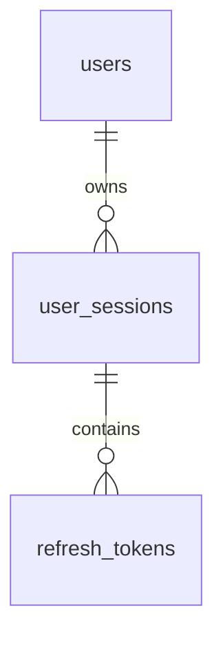

# EVRide – Thiết kế Cơ sở Dữ liệu PostgreSQL
> **Cập nhật:** 13/11/2026
> **Nguồn chuẩn hiện hành:** SQLAlchemy ORM tại `backend/app/models.py` (27 bảng) và lịch sử Alembic migration tại `backend/database/migrations/` (revision mới nhất trong mã nguồn: `f4c2a1b8e901`).

Tài liệu này mô tả cấu trúc cơ sở dữ liệu hiện hành trong mã nguồn. Lưu ý phân biệt với các bản xuất tham khảo lịch sử:
- `docs/ER_diagram.pdf` và `backend/database/stored_database/database.sql` là các bản thiết kế/xuất tham khảo từ giai đoạn 15–18 bảng ban đầu, không bao gồm các bảng bổ sung ở các revision sau (`user_sessions`, `refresh_tokens`, `rental_incidents`, v.v.).
- Môi trường kiểm thử `evride_test` đã kiểm chứng `alembic upgrade head` (`f4c2a1b8e901`); database phát triển `evride_db` cần được chạy `python -m alembic upgrade head` khi cập nhật backend.

---

## 1. TỔNG QUAN VỀ QUY TẮC VẬN HÀNH (BUSINESS RULES)

1. **Giữ chỗ xe:** Khách hàng chỉ được đặt xe đang ở trạng thái `AVAILABLE`. Thời gian giữ chỗ mặc định là **30 phút** (`expires_at = created_at + 30m`). Không hỗ trợ đặt trước nhiều ngày hoặc gia hạn lượt giữ chỗ.
2. **Hết hạn giữ chỗ:** Tại hoặc sau `expires_at`, lượt đặt chuyển sang `EXPIRED`. Xe sẽ được giải phóng về trạng thái `AVAILABLE` (trừ khi gặp sự cố/sửa chữa).
3. **Nhận xe (Pickup):** Khi nhân viên giao xe thành công, trạng thái chuyển sang `IN_RENT`. Xe rời trạm (`current_station_id = NULL`).
4. **Trả xe (Return):** Nhân viên tiếp nhận xe thực tế tại trạm còn chỗ, dừng cước và chuyển rental/vehicle sang `RETURN_PENDING`; quyết toán là giao dịch riêng, thành công mới chuyển rental `COMPLETED`.
5. **Khách và xe chặn độc lập:** Xe thu hồi/kiểm tra/giải phóng hợp lệ được thuê lại dù khách cũ còn nợ. Hai index hiện vẫn chặn theo cùng tập trạng thái; phải sửa predicate và mọi guard theo thiết kế sự cố, không chỉ bỏ STOLEN. Hết hạn giữ chỗ vẫn cập nhật trong transaction.

---

## 2. ĐỊNH NGHĨA BẢNG CƠ SỞ DỮ LIỆU (TABLE DEFINITIONS)

### 2.1. Quản lý Người dùng & Ví (Users & Wallets)

#### Bảng `users`
Lưu trữ thông tin tài khoản người dùng (Khách hàng, Nhân viên, Quản lý).

| Cột (Column) | Kiểu Dữ Liệu | Ràng Buộc / Mô Tả |
| :--- | :--- | :--- |
| `id` | `bigint` | **PK** |
| `name` | `varchar(100)` | NOT NULL |
| `email` | `varchar(100)` | UNIQUE, NOT NULL |
| `password` | `varchar(255)` | NOT NULL (Mật khẩu đã hash) |
| `role` | `varchar(20)` | NOT NULL (`CUSTOMER`, `STAFF`, `MANAGER`) |
| `status` | `varchar(20)` | NOT NULL (`ACTIVE`, `INACTIVE`, `BLOCKED`, `BLACKLISTED`) |
| `created_at` | `timestamptz` | NOT NULL |

#### Bảng `user_documents`
Lưu trữ giấy tờ định danh (eKYC) và bằng lái xe. Ảnh được tham chiếu qua `file_attachments`, không lưu URL file tùy ý.

| Cột (Column) | Kiểu Dữ Liệu | Ràng Buộc / Mô Tả |
| :--- | :--- | :--- |
| `id` | `bigint` | **PK** |
| `user_id` | `bigint` | **FK** -> `users.id`, NOT NULL |
| `document_type` | `varchar(30)` | NOT NULL (`CCCD`, `PASSPORT`, `DRIVER_LICENSE`) |
| `document_number` | `varchar(50)` | NOT NULL |
| `verified_status` | `varchar(20)` | NOT NULL (`PENDING`, `VERIFIED`, `REJECTED`) |
| `verified_birth_date` | `date` | NULL |
| `expires_on` | `date` | NULL |
| `verified_by` | `bigint` | FK -> `users.id`, NULL |
| `verified_at` | `timestamptz` | NULL |
| `revoked_at` | `timestamptz` | NULL |
| `created_at` | `timestamptz` | NOT NULL |

#### Bảng `wallets`
Ví điện tử và số dư của người dùng.

| Cột (Column) | Kiểu Dữ Liệu | Ràng Buộc / Mô Tả |
| :--- | :--- | :--- |
| `id` | `bigint` | **PK** |
| `user_id` | `bigint` | **FK** -> `users.id`, UNIQUE, NOT NULL |
| `balance` | `numeric(12,2)`| NOT NULL, Default: `0` |
| `status` | `varchar(20)` | NOT NULL (`ACTIVE`, `FROZEN`, `LOCKED`) |
| `created_at` | `timestamptz` | NOT NULL |
| `updated_at` | `timestamptz` | NOT NULL |

#### Bảng `user_sessions`
Quản lý phiên đăng nhập Rolling Session (mỗi lần đăng nhập tạo một phiên riêng, chia sẻ giữa các tab cùng trình duyệt).

| Cột (Column) | Kiểu Dữ Liệu | Ràng Buộc / Mô Tả |
| :--- | :--- | :--- |
| `id` | `uuid` | **PK** |
| `user_id` | `bigint` | **FK** -> `users.id` (`ON DELETE RESTRICT`), NOT NULL |
| `created_at` | `timestamptz` | NOT NULL |
| `last_used_at` | `timestamptz` | NOT NULL (`CHECK (last_used_at >= created_at)`) |
| `expires_at` | `timestamptz` | NOT NULL (`CHECK (expires_at > created_at)`) |
| `revoked_at` | `timestamptz` | NULL |
| `revoke_reason` | `varchar(40)` | NULL (`LOGOUT`, `PASSWORD_CHANGED`, `ACCOUNT_DISABLED`, `REFRESH_REUSE`) |
| `user_agent` | `varchar(512)` | NULL |
| `ip_address` | `varchar(64)` | NULL |

- **Indexes:** `ix_sessions_user` (`user_id`), `ix_sessions_expiry` (`expires_at`), `ix_sessions_revoked` (`revoked_at`).

#### Bảng `refresh_tokens`
Lưu lịch sử băm (SHA-256) của các thế hệ refresh token trong từng phiên để thực hiện Refresh Token Rotation, Grace Replay (15 giây) và phát hiện Reuse.

| Cột (Column) | Kiểu Dữ Liệu | Ràng Buộc / Mô Tả |
| :--- | :--- | :--- |
| `id` | `uuid` | **PK** |
| `session_id` | `uuid` | **FK** -> `user_sessions.id` (`ON DELETE CASCADE`), NOT NULL |
| `generation` | `int` | NOT NULL (`CHECK (generation >= 0)`) |
| `token_hash` | `varchar(64)` | UNIQUE, NOT NULL (`CHECK (char_length(token_hash) = 64)`) |
| `created_at` | `timestamptz` | NOT NULL |
| `expires_at` | `timestamptz` | NOT NULL (`CHECK (expires_at > created_at)`) |
| `used_at` | `timestamptz` | NULL (`CHECK (used_at IS NULL OR used_at >= created_at)`) |
| `replay_until` | `timestamptz` | NULL |
| `replay_ciphertext` | `text` | NULL (Bản mã Fernet cho kết quả replay trong grace) |

- **Constraints & Indexes:**
  - `uq_refresh_generation`: `UNIQUE (session_id, generation)` (nhận diện token kế tiếp bằng `generation + 1`, không cần self-FK `replacement_id`).
  - `ck_refresh_replay`: `(used_at IS NULL AND replay_until IS NULL AND replay_ciphertext IS NULL) OR (used_at IS NOT NULL AND replay_until IS NOT NULL AND replay_until >= used_at)`.
  - `uq_refresh_current`: Partial unique index trên `session_id` với `WHERE used_at IS NULL` (mỗi phiên chỉ có tối đa một refresh token chưa dùng).
  - `ix_refresh_replay_until` (`replay_until`).



---

### 2.2. Quản lý Trạm & Phương tiện (Stations & Vehicles)

#### Bảng `stations`
Thông tin các trạm xe điện, sức chứa và giờ hoạt động.

| Cột (Column) | Kiểu Dữ Liệu | Ràng Buộc / Mô Tả |
| :--- | :--- | :--- |
| `id` | `bigint` | **PK** |
| `name` | `varchar(120)` | NOT NULL |
| `address` | `text` | NOT NULL |
| `latitude` | `numeric(9,6)` | NOT NULL |
| `longitude` | `numeric(9,6)` | NOT NULL |
| `capacity` | `int` | NOT NULL (Sức chứa tối đa) |
| `opens_at` | `time` | NULL |
| `closes_at` | `time` | NULL |
| `status` | `varchar(20)` | NOT NULL |

#### Bảng `vehicles`
Danh sách phương tiện và trạng thái thực tế.

| Cột (Column) | Kiểu Dữ Liệu | Ràng Buộc / Mô Tả |
| :--- | :--- | :--- |
| `id` | `bigint` | **PK** |
| `current_station_id` | `bigint` | **FK** -> `stations.id` (NULL khi đang được thuê) |
| `name` | `varchar(100)` | NOT NULL |
| `model` | `varchar(100)` | NOT NULL (Mẫu xe; dùng để lọc xe và phạm vi khuyến mãi) |
| `battery_percent` | `int` | NOT NULL (0 - 100) |
| `status` | `varchar(20)` | NOT NULL (`AVAILABLE`, `RESERVED`, `RENTED`, `RETURN_PENDING`, `MAINTENANCE`, `SUSPECTED_STOLEN`, `STOLEN`) |
| `first_30_minutes_price` | `numeric(12,2)` | NOT NULL, CHECK >= 0 |
| `extra_minute_price` | `numeric(12,2)` | NOT NULL, CHECK >= 0 |
| `deposit_amount` | `numeric(12,2)`| NOT NULL |
| `created_at` | `timestamptz` | NOT NULL |

---

### 2.3. Quản lý Thuê xe & Bàn giao (Rentals & Handovers)

#### Bảng `rentals`
Thông tin chi tiết từng lượt đặt / thuê xe.

| Cột (Column) | Kiểu Dữ Liệu | Ràng Buộc / Mô Tả |
| :--- | :--- | :--- |
| `id` | `bigint` | **PK** |
| `customer_id` | `bigint` | **FK** -> `users.id`, NOT NULL |
| `vehicle_id` | `bigint` | **FK** -> `vehicles.id`, NOT NULL |
| `pickup_station_id` | `bigint` | **FK** -> `stations.id`, NOT NULL |
| `actual_return_station_id` | `bigint` | **FK** -> `stations.id`, NULL |
| `expires_at` | `timestamptz` | NOT NULL (Backend ấn định bằng `created_at + 30m`; client không truyền) |
| `actual_start_time` | `timestamptz` | NULL (Thời điểm nhận xe thực tế) |
| `actual_end_time` | `timestamptz` | NULL (Thời điểm trả xe thực tế) |
| `return_initiated_at` | `timestamptz` | NULL (mốc dừng cước trả xe thông thường, bất biến sau tiếp nhận) |
| `settled_at` | `timestamptz` | NULL (thời điểm quyết toán luồng thường, sau `return_initiated_at`) |
| `next_check_at` | `timestamptz` | NULL (lịch kiểm tra tiếp theo cho danh sách `/rental-check-ins`; lần đầu dùng `actual_start_time + 24h`) |
| `vehicle_released_at` | `timestamptz` | NULL (dấu `MANAGER` giải phóng xe sự cố để cho khách mới thuê) |
| `vehicle_released_by` | `bigint` | **FK** -> `users.id`, NULL |
| `vehicle_release_note` | `text` | NULL (ghi chú giải phóng xe, bắt buộc khác rỗng khi `vehicle_released_at IS NOT NULL`) |
| `cancelled_at` | `timestamptz` | NULL |
| `cancellation_reason` | `varchar(100)` | NULL |
| `cancellation_limit_exempt` | `boolean` | NOT NULL, default false |
| `deposit_held` | `numeric(12,2)` | NOT NULL, default 0, CHECK >= 0 |
| `status` | `varchar(20)` | NOT NULL, Default: `'RESERVED'` (`RESERVED`, `IN_RENT`, `RETURN_PENDING`, `STOLEN`, `INCIDENT_PENDING`, `CLOSED_INCIDENT`, `COMPLETED`, `CANCELLED`, `EXPIRED`) |
| `total_price` | `numeric(12,2)`| NULL (Tiền thuê sau tính toán; không gộp bồi thường sự cố) |
| `created_at` | `timestamptz` | NOT NULL |

- **Indexes:**
  - `idx_rentals_status_expires_at` (`status`, `expires_at`)
  - `idx_rentals_customer_created_at` (`customer_id`, `created_at`)
  - `idx_rentals_vehicle_id` (`vehicle_id`)
  - `ix_rentals_in_rent_check` (`next_check_at`) WHERE `status = 'IN_RENT'` (hỗ trợ danh sách `/rental-check-ins`)
  - `uq_active_customer_rental` (`customer_id`) WHERE `status IN ('RESERVED', 'IN_RENT', 'RETURN_PENDING', 'STOLEN', 'INCIDENT_PENDING')`
  - `uq_active_vehicle_rental` (`vehicle_id`) WHERE `status IN ('RESERVED', 'IN_RENT', 'RETURN_PENDING', 'STOLEN', 'INCIDENT_PENDING', 'CLOSED_INCIDENT') AND vehicle_released_at IS NULL`
  - CHECK thời gian bắt đầu/kết thúc/nhận xe/quyết toán theo thứ tự; trạng thái hết hạn phải được cập nhật trong transaction trước khi đặt mới.

#### Bảng `handovers`
Biên bản giao/nhận xe do nhân viên xác thực tại trạm.

| Cột (Column) | Kiểu Dữ Liệu | Ràng Buộc / Mô Tả |
| :--- | :--- | :--- |
| `id` | `bigint` | **PK** |
| `rental_id` | `bigint` | **FK** -> `rentals.id`, NOT NULL |
| `staff_id` | `bigint` | **FK** -> `users.id`, NOT NULL |
| `kind` | `varchar(10)` | NOT NULL (`PICKUP` - Giao xe, `RETURN` - Nhận lại xe) |
| `time` | `timestamptz` | NOT NULL |
| `battery_percent` | `int` | NOT NULL |
| `vehicle_condition` | `varchar(30)` | NULL (`OK`, `NEEDS_MAINTENANCE`) |
| `note` | `text` | NULL |
| `created_at` | `timestamptz` | NOT NULL |

- **Indexes:**
  - `uq_handovers_rental_kind` UNIQUE (`rental_id`, `kind`)

#### Bảng `rental_reviews`
Đánh giá chất lượng sau chuyến đi.

| Cột (Column) | Kiểu Dữ Liệu | Ràng Buộc / Mô Tả |
| :--- | :--- | :--- |
| `id` | `bigint` | **PK** |
| `rental_id` | `bigint` | **FK** -> `rentals.id`, UNIQUE, NOT NULL |
| `rating` | `int` | NOT NULL (1 đến 5 sao) |
| `comment` | `text` | NULL |
| `created_at` | `timestamptz` | NOT NULL |

---

### 2.4. Tài chính, Thanh toán & Khuyến mãi (Financials & Promotions)

#### Bảng `invoices`
Hóa đơn thanh toán cho chuyến đi.

| Cột (Column) | Kiểu Dữ Liệu | Ràng Buộc / Mô Tả |
| :--- | :--- | :--- |
| `id` | `bigint` | **PK** |
| `rental_id` | `bigint` | **FK** -> `rentals.id`, UNIQUE, NOT NULL |
| `total_amount` | `numeric(12,2)`| NOT NULL |
| `status` | `varchar(20)` | NOT NULL (`UNPAID`, `PAID`, `CANCELLED`) |
| `created_at` | `timestamptz` | NOT NULL |

#### Bảng `transactions`
Lịch sử giao dịch liên quan đến đơn thuê.

| Cột (Column) | Kiểu Dữ Liệu | Ràng Buộc / Mô Tả |
| :--- | :--- | :--- |
| `id` | `bigint` | **PK** |
| `rental_id` | `bigint` | **FK** -> `rentals.id`, NOT NULL |
| `invoice_id` | `bigint` | **FK** -> `invoices.id`, NULL |
| `actor_id` | `bigint` | **FK** -> `users.id`, NOT NULL |
| `idempotency_record_id` | `bigint` | **FK** -> `idempotency_records.id`, NULL |
| `amount` | `numeric(12,2)`| NOT NULL |
| `kind` | `varchar(20)` | NOT NULL (`PAYMENT`, `DEPOSIT`, `REFUND`, `FEE`) |
| `status` | `varchar(20)` | NOT NULL (`PENDING`, `SUCCESS`, `FAILED`) |
| `created_at` | `timestamptz` | NOT NULL |

#### Bảng `wallet_transactions`
Biến động số dư ví cá nhân.

| Cột (Column) | Kiểu Dữ Liệu | Ràng Buộc / Mô Tả |
| :--- | :--- | :--- |
| `id` | `bigint` | **PK** |
| `wallet_id` | `bigint` | **FK** -> `wallets.id`, NOT NULL |
| `rental_id` | `bigint` | **FK** -> `rentals.id`, NULL |
| `transaction_id` | `bigint` | **FK** -> `transactions.id`, UNIQUE, NULL |
| `idempotency_record_id` | `bigint` | **FK** -> `idempotency_records.id`, NULL |
| `amount` | `numeric(12,2)`| NOT NULL |
| `type` | `varchar(30)` | NOT NULL (`TOPUP`, `WITHDRAW`, `RENTAL_PAYMENT`, `RENTAL_DEPOSIT`, `RENTAL_REFUND`) |
| `balance_before` | `numeric(12,2)`| NOT NULL |
| `balance_after` | `numeric(12,2)`| NOT NULL |
| `status` | `varchar(20)` | NOT NULL (`PENDING`, `SUCCESS`, `FAILED`) |
| `created_at` | `timestamptz` | NOT NULL |

#### Bảng `promotions` & `user_promotions`
Chương trình khuyến mãi và ví voucher của người dùng.

* **`promotions`**: `id`, `code` (UNIQUE), `description`, `discount_type` (`PERCENTAGE`/`FIXED_AMOUNT`), `discount_value`, `max_discount_amount` (chỉ dùng với `PERCENTAGE`), `min_rental_amount`, `vehicle_model`, `usage_limit`, `used_count`, `start_date`, `end_date`, `status` (`ACTIVE`/`EXPIRED`/`DISABLED`), `created_at`.
  `PERCENTAGE` dùng giá trị nguyên 1–100; `FIXED_AMOUNT` dùng số tiền dương VND. Mức giảm không vượt tiền thuê; `max_discount_amount` chỉ giới hạn giảm phần trăm. `vehicle_model` là điều kiện tùy chọn, NULL nghĩa là áp dụng cho mọi mẫu xe; so khớp với `vehicles.model` không phân biệt hoa thường. Vì phạm vi dự án chỉ có xe điện, promotion không lọc thêm theo loại xe.
  `usage_limit` là giới hạn tổng số lần áp dụng; `used_count` do backend cập nhật. Mã mới phải có giới hạn dương. NULL chỉ dành cho mã cũ chưa được cấu hình hạn mức và được hiểu là chưa giới hạn cho tới khi quản trị cấu hình.
* **`user_promotions`**: `id`, `user_id` (FK), `promotion_id` (FK), `is_used` (boolean), `used_at` (timestamptz). `UNIQUE (user_id, promotion_id)` ngăn nhận trùng; mỗi người dùng chỉ dùng một lần.
  Khi thanh toán, khóa promotion rồi claim, kiểm tra lại hiệu lực/phạm vi/hạn mức và tăng `used_count` cùng cập nhật `is_used` trong transaction thanh toán. Quote không tiêu thụ lượt; claim cũng không giữ chỗ lượt dùng.

---

### 2.5. Idempotency, audit và snapshot tài chính

#### Bảng `idempotency_records`
Lưu bền vững request và response để nhận diện retry, phát hiện cùng key khác body và replay kết quả sau timeout. Khóa phạm vi là `(actor_id, http_method, request_path, idempotency_key)`; `request_hash` là SHA-256 của body. `PROCESSING` chưa có response; `COMPLETED` giữ HTTP status và JSON response. `expires_at` không sớm hơn 24 giờ sau khi tạo; chỉ dọn record đã hết hạn.

#### Bảng `rental_pricing_snapshots`
Mỗi lượt thuê có tối đa một snapshot bất biến theo quy ước ứng dụng: lưu tên và mẫu xe, giá 30 phút đầu, giá phút thêm, tiền cọc, phiên bản/JSON chính sách giá, đơn vị tính phí và promotion/code/loại/giá trị/mức giảm đã áp dụng. Khóa ngoại promotion có thể rỗng nếu promotion bị xóa; code và điều khoản/giá trị áp dụng vẫn được giữ lại.

#### Bảng `audit_logs`
Lưu actor, action, loại/ID tài nguyên, request ID, JSON trước/sau và thời điểm. Nhật ký được append-only theo quy ước ứng dụng; không ghi mật khẩu, token, dữ liệu giấy tờ nhạy cảm hoặc bí mật khác vào payload audit.

---

### 2.6. Hỗ trợ & Giám sát (Support & Tracking)

* **`support_tickets`**: `id`, `rental_id` (FK), `created_by` (FK -> `users`), `assigned_to` (FK -> `users`), `title`, `description`, `status` (`OPEN`, `IN_PROGRESS`, `RESOLVED`, `CLOSED`), `resolution_note`, `resolved_at`, `created_at`, `updated_at`.
* **`gps_points`**: `id`, `rental_id` (FK), `latitude`, `longitude`, `recorded_at`.

### 2.7. Bảng quản trị giá, bảo trì, ảnh và điều chuyển

Các bảng dưới đã có ORM và migration trong source; API quản trị giá, bảo trì,
file và điều chuyển đã có code. Upload intent/URL ký và mọi loại attachment
trong contract chưa đồng nghĩa đã triển khai đầy đủ. Có code không chứng
minh đã kiểm thử thành công.

* **`vehicle_pricing_history`**: `id`, `vehicle_id` (FK), `version_number`, giá/cọc cũ nullable và giá/cọc mới (`first_30_minutes_price`, `extra_minute_price`, `deposit_amount`), `changed_by` (FK -> users), `created_at`. UNIQUE (`vehicle_id`, `version_number`); CHECK version > 0, mọi giá không âm. Phiên bản đầu có giá cũ NULL. Ghi lịch sử và cập nhật `vehicles` trong cùng transaction; trigger DB chặn UPDATE/DELETE.
* **`maintenance_orders`**: `id`, `vehicle_id` (FK -> `vehicles.id`), `incident_id` (FK nullable -> `rental_incidents.id`, ON DELETE RESTRICT, index `ix_maintenance_orders_incident`), `created_by`/`assigned_to` (FK -> `users.id`), `title`, `description`, `status` (`OPEN`, `IN_PROGRESS`, `COMPLETED`, `CANCELLED`), `opened_at`, `started_at`, `completed_at`, `resolution_note`, `created_at`, `updated_at`. CHECK trạng thái/mốc thời gian; partial unique index một phiếu `OPEN`/`IN_PROGRESS` trên mỗi xe. Dùng chung cho cả xe thường và xe sự cố đã về trạm. Không coi `support_tickets` là phiếu bảo trì.
* **`stored_files`**: metadata file riêng tư gồm object key UNIQUE, tên gốc, MIME, byte size, SHA-256, trạng thái (`PENDING`, `READY`, `REJECTED`), uploader (FK -> users), `created_at`, `verified_at`. CHECK chỉ JPEG/PNG/WebP, 1–10 MiB và SHA-256 64 ký tự.
* **`file_attachments`**: `file_id` (FK UNIQUE), đúng một FK owner trong `vehicle_id`, `maintenance_order_id`, `handover_id`, `user_document_id`, `support_ticket_id`; `purpose`, `attached_by` (FK -> users), `created_at`. CHECK đúng một owner và purpose thuộc enum contract. URL ký ngắn hạn là thiết kế mở rộng; code hiện tải qua endpoint kiểm tra quyền, không công khai object key.
* **`vehicle_move_audits`**: `vehicle_id`, `from_station_id`, `to_station_id`, `actor_id` (các FK), `idempotency_record_id` (FK nullable UNIQUE), `note`, `moved_at`. CHECK trạm nguồn khác trạm đích; trigger DB chặn UPDATE/DELETE. Cập nhật vị trí xe và audit cùng transaction.

API tương ứng xem `api-contract.md`, phân biệt code hiện có với endpoint
dự kiến. File hiện phục vụ qua lưu trữ cục bộ và endpoint kiểm tra quyền;
URL ký là thiết kế mở rộng. Tiền `numeric(12,2)`, thời gian `timestamptz` UTC;
JSON ID/tiền string. Helper `operations.output` hiện chuyển Decimal thành
float; cần serializer phù hợp trước khi dùng cho tài chính sự cố mới.

### 2.8. Hồ sơ sự cố (`rental_incidents`, đã triển khai tới `f4c2a1b8e901`)

Bảng `rental_incidents` (1–1 với `rentals.id`) lưu hồ sơ tiếp nhận, xác minh, thu hồi/về trạm, mốc quyết toán thuê, thông tin bồi thường ngoài hệ thống và mốc đóng hồ sơ:

- **Định danh & tiếp nhận**: `id`, `rental_id` (UNIQUE FK -> `rentals.id`), `initial_ticket_id` (FK -> `support_tickets.id`), `source` (`CUSTOMER_REPORT`, `STAFF_REPORT`, `SYSTEM_ALERT`), `status` (`OPEN`, `INVESTIGATING`, `CONFIRMED`, `DISMISSED`, `CLOSED`), `assigned_to` (nullable để tương thích dữ liệu cũ; luồng hiện hành không yêu cầu gán người xử lý).
- **Xác minh & dừng cước**: `verified_outcome` (`FALSE_ALARM`, `LOSS_THEFT`, `ABANDONMENT`), `verification_reason`, `verified_by`, `verified_at`, `valid_report_ticket_id`, `valid_report_received_at`, `billing_cutoff_at`, `billing_cutoff_reason` (`VALID_REPORT`, `RECOVERED_AT`).
- **Thu hồi & về trạm**: `recovered_at`, `received_by`, `recovery_note`, `arrived_station_at`, `received_station_id`, `station_received_by`, `recovery_condition` (`INTACT`, `REPAIRABLE`, `UNREPAIRABLE`), `inspected_at` (ghi nhận cùng lúc tại `arrival`), `inspected_by`, `inspection_note`, `inspection_ticket_id`.
- **Bồi thường ngoài hệ thống**: `compensation_assessed_amount` (`numeric(12,2)` nullable; `null` = chưa xác định, `0.00` = xác nhận không phải bồi thường), `agreement_status` (`PENDING`, `NOT_REQUIRED`, `AGREED`, `AUTHORITY_DECISION`, `DISPUTED`), `compensation_basis`, `compensation_approved_by`, `compensation_approved_at`, `compensation_ticket_id`, `compensation_settled_at`. Chi tiết thanh toán ngoài hệ thống (`payment_method`, `payment_reference`, `paid_at`) được lưu kèm trong `AuditLog` (`RENTAL_INCIDENT_EXTERNAL_COMPENSATION_SETTLED`). Các cột định giá cũ (`vehicle_value_snapshot`, `valuation_*`, `approved_repair_cost`, `repair_cost_*`, `recovered_asset_*`, `compensation_proposed_amount`) giữ nullable để bảo toàn schema lịch sử.
- **Đóng hồ sơ & liên kết**: `rent_settled_at`, `closed_at`, `closed_by`, `closure_note`. `transactions.incident_id` (nullable FK -> `rental_incidents.id`) liên kết bút toán tiền thuê/hoàn cọc sự cố; bồi thường ngoài hệ thống **không** tạo `Transaction`/`WalletTransaction`.
- **Phản ánh sau `COMPLETED`**: chỉ tạo `support_tickets`/bằng chứng, không mở hồ sơ tài chính mới. Thu hồi sau `CLOSED_INCIDENT` ghi nhận trên hồ sơ cũ, không mở lại `rental`.

Chi tiết API và quy tắc nghiệp vụ xem tại [api-contract.md](api-contract.md) (Mục 9) và [architecture.md](architecture.md).

---

## 3. MỐI QUAN HỆ CƠ SỞ DỮ LIỆU (RELATIONSHIPS SUMMARY)

```text
users (1) <---> (1) wallets
users (1) <---> (N) user_sessions
user_sessions (1) <---> (N) refresh_tokens
users (1) <---> (N) user_documents
users (1) <---> (N) rentals (as customer)
users (1) <---> (N) handovers (as staff)
users (1) <---> (N) support_tickets (as creator/assignee)

stations (1) <---> (N) vehicles (current location)
stations (1) <---> (N) rentals (pickup / return station)

vehicles (1) <---> (N) rentals

rentals (1) <---> (1) rental_reviews
rentals (1) <---> (1) invoices
rentals (1) <---> (N) handovers (Max 2: PICKUP & RETURN)
rentals (1) <---> (N) transactions
rentals (1) <---> (N) gps_points
rentals (1) <---> (N) support_tickets
vehicles (1) <---> (N) vehicle_pricing_history / maintenance_orders / vehicle_move_audits
stored_files (1) <---> (0..1) file_attachments

wallets (1) <---> (N) wallet_transactions
promotions (1) <---> (N) user_promotions
rentals (1) <---> (1) rental_pricing_snapshots
transactions (1) <---> (0..1) wallet_transactions
idempotency_records (1) <---> (N) transactions / wallet_transactions
users (1) <---> (N) audit_logs / vehicle_move_audits
```

---

## 4. QUY TẮC KỸ THUẬT (MIGRATIONS & BACKEND LOGIC)

Alembic revision nằm tại `backend/database/migrations/`; chạy từ `backend/`.
ORM `backend/app/models.py` mô tả schema hiện tại trong source. Kiểm tra
`heads`/`current` và review migration trên DB thử trước khi upgrade lên `evride_db`.
Không dùng `create_all()` trong lúc chạy ứng dụng.

Revision `888ad91e139e` bổ sung lịch sử giá, phiếu bảo trì, kho file/đính kèm, audit điều chuyển và báo giá trả xe; đồng thời thêm CHECK còn thiếu, mở rộng unique rental sang `RETURN_PENDING` và cấm UPDATE/DELETE lịch sử giá/audit điều chuyển. Migration cố ý dừng nếu database có xe hoặc snapshot giá cũ, URL ảnh giấy tờ chưa chuyển sang kho riêng tư, hay giấy tờ VERIFIED chưa có dữ liệu xác minh mới. Không suy diễn giá block đầu/phút từ `daily_price`; cần lập kế hoạch chuyển đổi dữ liệu trước khi chạy migration trên môi trường có dữ liệu.

Revision `d3f914a27c6b` bổ sung mẫu xe riêng, hai kiểu giảm, phạm vi xe và hạn mức lượt dùng. Revision `f73c21e84a6b` bỏ bộ lọc `vehicle_type`, giữ phạm vi theo mẫu xe. Mẫu xe dữ liệu cũ được backfill từ `vehicles.name`; số lượt đã dùng được backfill từ các claim `is_used`. Mã cũ giữ `usage_limit = NULL` vì không thể suy ra hạn mức lịch sử; mã mới phải khai báo hạn mức dương. Migration dừng nếu gặp khuyến mãi/snapshot có phần trăm không hợp lệ thay vì tự sửa dữ liệu. Service `app/services/promotions.py` tính mức giảm và tiêu thụ claim/hạn mức trong transaction do caller quản lý; quote/thanh toán thông thường đã gọi service này; luồng sự cố mới phải không apply/consume mã.

Revision `b18f7e4c2a91` loại bỏ phân loại `vehicles.type` và `rental_pricing_snapshots.vehicle_type_snapshot`; `vehicles.model`/`vehicle_model_snapshot` là trường mẫu xe duy nhất. Cập nhật schema bằng `alembic upgrade head` trước khi chạy phiên bản backend mới.

Revision `de606e75dbc8` (cha `b18f7e4c2a91`) bổ sung dữ liệu xử lý ticket và ràng buộc/index GPS.

Revision `e8a412c9f603` bổ sung bảng `rental_incidents`, trạng thái `INCIDENT_PENDING`/`CLOSED_INCIDENT`, dấu giải phóng xe trên `rentals`, và liên kết `transactions.incident_id`.

Revision `f4c2a1b8e901` (cha `e8a412c9f603`) thu gọn phân hệ sự cố & kiểm tra 24 giờ: thêm `rentals.next_check_at` + partial index `ix_rentals_in_rent_check`, thêm `maintenance_orders.incident_id` + index `ix_maintenance_orders_incident`, bỏ ràng buộc bắt buộc `rental_incidents.assigned_to`, và bỏ ràng buộc cảnh báo thừa. Đã kiểm chứng upgrade/downgrade/`alembic check` trên `evride_test`; `evride_db` cần chạy `alembic upgrade head` khi triển khai.

### 4.1. Xử lý Thời gian & Hết hạn giữ xe
* **Múi giờ:** Luôn lưu dưới dạng `timestamptz` (thống nhất chuẩn UTC trong CSDL).
* **Tự động hết hạn:** Backend tính toán `expires_at = created_at + INTERVAL '30 minutes'`.
* **Ràng buộc khi nhận xe:** Khách chỉ được nhận xe khi `status = 'RESERVED'` và thời điểm server lấy sau khóa nhỏ hơn `expires_at`; không dùng `NOW()` của đầu transaction sau khi đã chờ khóa.
* **Giải phóng xe:** Lazy expiration trong cùng transaction với thao tác đặt mới phải cập nhật `RESERVED` -> `EXPIRED` trước khi xét unique index; job nền chỉ là tối ưu, không phải nguồn quyết định duy nhất.

### 4.2. Khóa chống Tranh chấp (Concurrency & Locking)
* **Partial Unique Index hiện hành (từ `e8a412c9f603` trở đi):** Tách điều kiện chặn khách khỏi quyền sử dụng xe để xe sự cố đã giải phóng (`vehicle_released_at IS NOT NULL`) cho phép khách mới thuê:
  ```sql
  CREATE UNIQUE INDEX uq_active_vehicle_rental
  ON rentals (vehicle_id)
  WHERE status IN ('RESERVED', 'IN_RENT', 'RETURN_PENDING', 'STOLEN', 'INCIDENT_PENDING', 'CLOSED_INCIDENT')
    AND vehicle_released_at IS NULL;

  CREATE UNIQUE INDEX uq_active_customer_rental
  ON rentals (customer_id)
  WHERE status IN ('RESERVED', 'IN_RENT', 'RETURN_PENDING', 'STOLEN', 'INCIDENT_PENDING');
  ```
* **Pessimistic Locking (`SELECT ... FOR UPDATE`):**
  * Thứ tự chung: `station → customer(users) → wallet → vehicle → rental`; trong nhóm khóa ID tăng dần. Thực hiện trên cùng DB transaction, sau khóa đọc lại và kiểm tra điều kiện.
  * Cùng một customer đặt hai xe đồng thời phải khóa dòng customer và vẫn dựa vào unique index để bảo vệ cuối cùng. Test concurrency chạy trên PostgreSQL thật.
  * Cập nhật trạng thái hết hạn, xe, snapshot, sổ cái và audit theo đúng phạm vi transaction. Lỗi trước commit rollback toàn bộ; retry cùng idempotency key/body replay kết quả, không ghi thêm lịch sử/audit; cùng key khác body trả `409 IDEMPOTENCY_CONFLICT`.
  * Sau khi khóa các tài nguyên nghiệp vụ của rental, khóa promotion rồi claim trước khi tiêu thụ mã; `used_count` và `user_promotions.is_used/used_at` phải commit/rollback cùng quyết toán.

### 4.3. Kiểm tra Sức chứa Trạm (Station Capacity)
* Số chỗ đang dùng = tất cả xe có `current_station_id = station_id`, gồm AVAILABLE, RESERVED, RETURN_PENDING và MAINTENANCE.
* Nhận trả/điều chuyển/nhận xe thu hồi vào trạm phải khóa trạm và kiểm tra capacity. Nhận lại cùng sự kiện không chiếm chỗ hai lần.
* Thu hồi ngoài trạm chưa gán current_station_id; chỉ ghi khi thực sự đến trạm. Quyết toán hồ sơ cũ không kiểm thêm chỗ hoặc ghi đè vị trí xe ở chuyến mới.

### 4.4. Check Constraints & Ràng buộc Dữ liệu
* `capacity > 0`
* `battery_percent BETWEEN 0 AND 100`
* `rating BETWEEN 1 AND 5`
* Các trường giá tiền/số dư phải $\ge 0$.
* Promotion: loại giảm là `PERCENTAGE` (1–100, số nguyên) hoặc `FIXED_AMOUNT` (> 0); hạn mức NULL hoặc dương; `0 <= used_count <= usage_limit` khi có hạn mức.
* Mốc thời gian chuyến, nhận xe, trả xe, quyết toán, bảo trì phải theo thứ tự; email, một ví/người, hóa đơn/chuyến, review/chuyến, handover/chuyến+loại và claim mã/người có UNIQUE.
* Mật khẩu (`users.password`) **bắt buộc** phải là chuỗi đã được hash (Bcrypt, Argon2,...), tuyệt đối không lưu plaintext.
